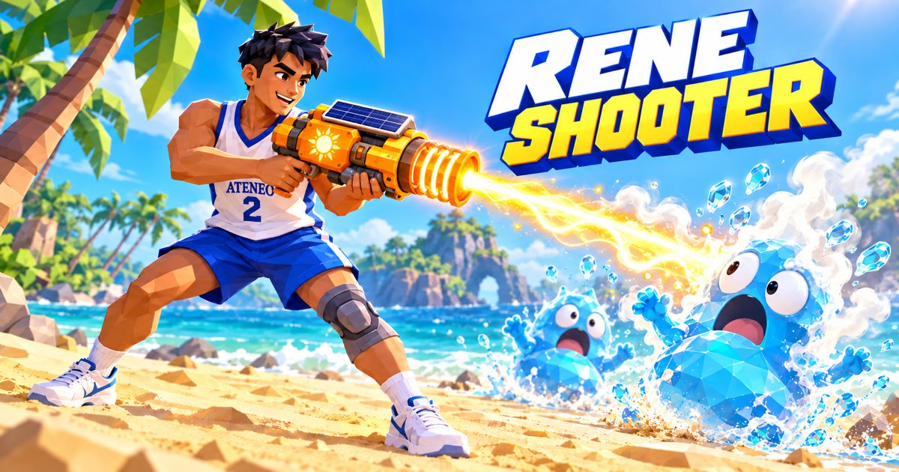

# RENE SHOOTER — Beach Dry-Out Showdown



**▶ Play it live: https://lemonadev03.github.io/rene-shooter/**

A third-person beach shooter built with Three.js. You play Rene: a 3D model based on the Ateneo #2 photo (white "ATENEO" #2 jersey with "RENE" on the back, blue shorts, grey knee brace on the left leg, white shoes), armed with the Solar Soaker (Sun-Dry 3000) heat blaster, fighting waves of water monsters on a beach. Firing heats the gun up and drains coolant; pools and the ocean cool it back down.

Powerups drop around the beach (⚡ Rapid Ray, ☀️ Mega Heat, 👟 Speed Soda, ❤️ +40 HP, 🧂 Salt Storm). Cool the gun at the wandering inflatable beach pools or with a quick ocean dip — but don't camp in the ocean: after a 4-second grace dip, the rip current drains HP harder the longer you stay in, so keep roaming the island.

Eight monster types, each with its own trick: zigzag **Droplets**; **Tide Brutes** that ground-slam (jump to dodge); water-jet **Jetters** (burst-fire on later waves); **Surfers** that telegraph then lunge; **Gushers** that swell up and burst up close; **Puddlers** that pop into two droplets; **Coral Wardens** hiding behind breakable shell shields; and **Rain Shamans** that heal their pack. Water monsters regenerate and speed up in the ocean and pools — lure them onto dry sand — kill them first. Waves ramp in count, HP, and speed across all five waves.

## Run

```bash
python3 -m http.server 8765 --bind 127.0.0.1 --directory .
```

Open http://127.0.0.1:8765/index.html

## Controls

- WASD move, mouse look (pointer lock; drag also works)
- LMB blast (1 = heat ray, 2 = sponge burst), RMB aim (shoulder zoom)
- Shift sprint, Space double-jump, Ctrl/C slide
- R cool faster in the ocean or a wandering pool (standing in either cools automatically; the meter is gun coolant)
- 1 / 2 switch Stream / Burst
- Touch: virtual joystick + FIRE/AIM/JUMP buttons

Survive 5 waves of water monsters, from droplets and surfers to coral wardens and rain shamans.

Files: `index.html`, `style.css`, `game.js` (Three.js 0.160 via CDN import map).
